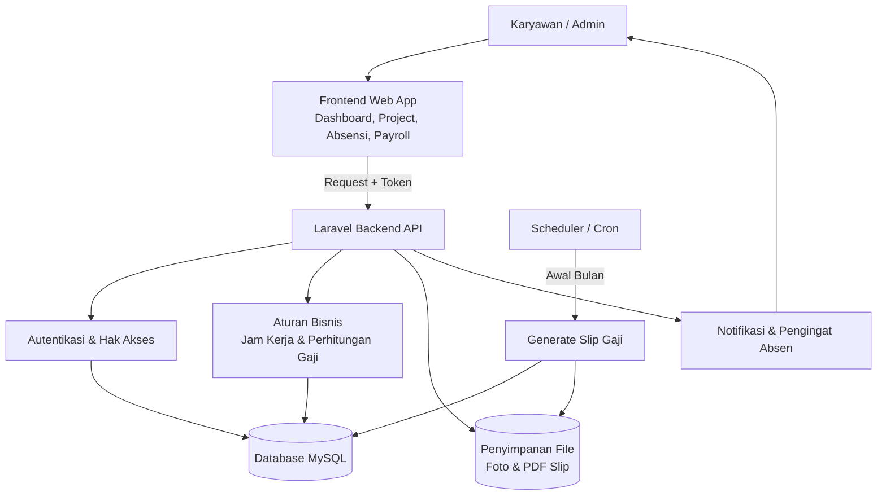
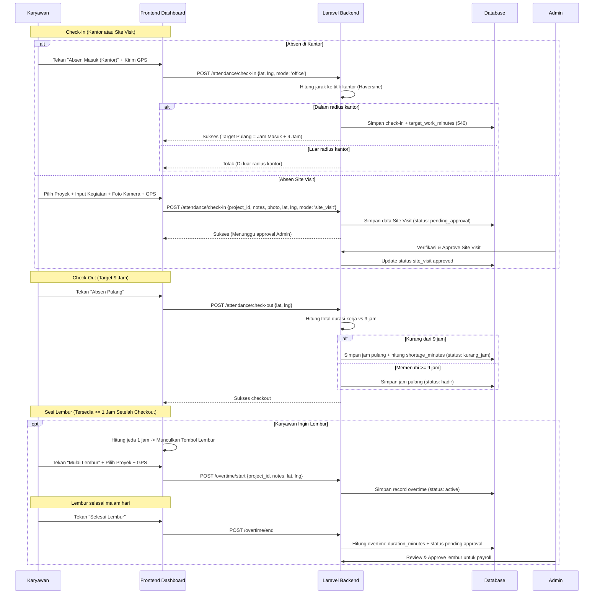
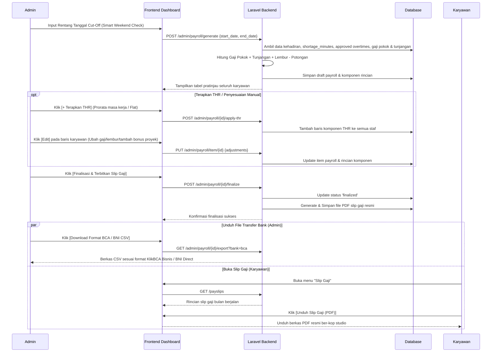
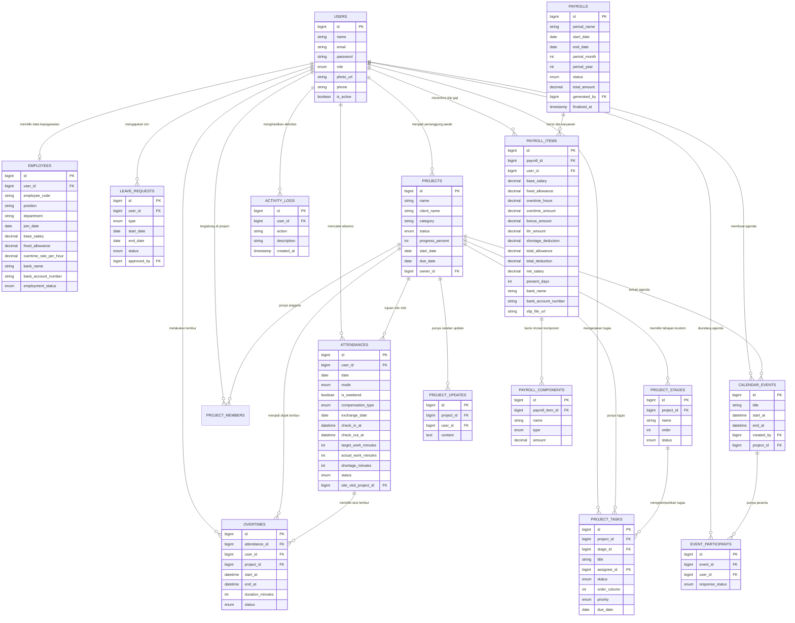

# PRD — Project Requirements Document

## 1. Overview

**Masalah yang diselesaikan**

Studio arsitektur saat ini menjalankan tiga hal penting secara manual dan tersebar: progres project dicatat di tempat berbeda-beda (chat, spreadsheet, catatan pribadi), kehadiran karyawan dicatat secara manual sehingga rawan salah rekap, dan penggajian dihitung lalu ditransfer satu per satu setiap bulan. Akibatnya admin studio menghabiskan banyak waktu untuk pekerjaan administratif, sementara karyawan tidak punya gambaran jelas tentang pekerjaan, jadwal, dan hak gajinya.

**Tujuan utama aplikasi**

Membuat satu dashboard karyawan berbasis web yang menyatukan tiga kebutuhan inti studio arsitektur:

1. **Project management** — semua project studio yang berjalan terkelola rapi dengan kartu visual dan board progres ala Notion.
2. **Absensi harian & lembur** — kehadiran fleksibel 9 jam kerja berbasis GPS kantor & Site Visit, serta lembur malam otomatis.
3. **Payroll gaji & slip otomatis** — smart cut-off fleksibel, kalkulasi otomatis absensi & lembur, THR 1-klik, ekspor transfer BCA/BNI, dan unduh slip gaji PDF.

**Target pengguna**

Karyawan dan admin studio arsitektur (skala kecil–menengah, sekitar 5–50 orang). Dua peran utama: **Karyawan** (absen, lihat project & tugas, lihat slip gaji, lihat kalender tim) dan **Admin studio** (mengelola project, absensi, jadwal, dan payroll seluruh tim).

**Nilai utama**

"Semua jadi satu tempat." Alasan karyawan kembali membuka aplikasi setiap hari adalah **absen pagi** — satu kebiasaan sederhana yang menjadi pintu masuk ke seluruh fitur lainnya. Halaman pertama yang dilihat adalah **Ringkasan Hari Ini**, yang langsung memperlihatkan kondisi hari itu dalam satu layar.

---

## 2. Requirements

**Persyaratan fungsional utama**

- Aplikasi berbasis web yang bisa diakses dari laptop dan ponsel (responsif), karena absensi dilakukan karyawan di pagi hari sering lewat ponsel.
- Tiga modul inti wajib tersedia: **Project Management**, **Absensi Harian & Lembur**, dan **Payroll / Slip Gaji Otomatis**.
- Dashboard utama menampilkan ringkasan hari ini: angka penting, agenda, aktivitas terbaru, pintasan cepat, dan **Widget Status Absensi Adaptif**.
- **Project Management Berbasis Peran:**
  - *Admin:* Mengelola seluruh proyek studio, menambah proyek baru, menginput tahapan kustom secara manual, menentukan penanggung jawab (Lead) dan anggota tim (Drafter, 3D Artist, dll.).
  - *Karyawan:* Menampilkan proyek di mana karyawan tersebut di-assign, memantau tugas pribadinya, dan memperbarui status progres.
  - *Board Progres ala Notion (Drag & Drop):* 4 kolom status kanban standar (`To Do`, `In Progress`, `In Review`, `Done`) yang interaktif dan otomatis mengalkulasi persentase progres proyek.
- **Kalender Studio Terintegrasi:** Menghubungkan timeline deadline proyek, milestone tahapan, jadwal site visit ke lapangan, dan agenda rapat/pertemuan studio yang otomatis tersinkronisasi ke Dashboard Utama.
- **Jam Kerja Fleksibel (Target 9 Jam):** Karyawan bebas menentukan jam masuk; sistem otomatis menetapkan target checkout minimal 9 jam setelah jam check-in. Checkout dini (< 9 jam) mencatat kekurangan menit kerja (*shortage minutes*).
- **Validasi Geofencing GPS Kantor:** Absen masuk dan pulang di kantor memvalidasi koordinat GPS perangkat terhadap radius kantor studio (mis. 50–100 meter).
- **Dukungan Site Visit (Tugas Lapangan):** Karyawan yang langsung bertugas ke lokasi proyek dapat melakukan absen Site Visit dengan memilih proyek terkait, mengunggah foto bukti kamera di lokasi proyek, mencatat titik GPS lapangan, dan menunggu persetujuan admin.
- **Sistem Lembur Otomatis:** Tombol lembur muncul otomatis di dashboard setelah jeda 1 jam dari waktu absen pulang normal, terhubung ke proyek yang dilemburkan dan tercatat durasinya untuk kalkulasi payroll.
- **Kebijakan Absensi Akhir Pekan (Sabtu & Minggu):**
  - Hari kerja resmi studio adalah **Senin s/d Jumat**.
  - Jika karyawan melakukan absensi di kantor atau site visit lapangan pada hari Sabtu atau Minggu, sistem otomatis memberikan 2 opsi kompensasi:
    - *Opsi 1 (Uang Lembur Akhir Pekan):* Seluruh jam kerja dikonversi menjadi jam lembur untuk diverifikasi admin dan dibayarkan pada payroll.
    - *Opsi 2 (Kompensasi Ganti Hari Libur):* Karyawan memilih 1 tanggal hari kerja biasa (Senin–Jumat) sebagai hari libur pengganti. Setelah disetujui admin, pada tanggal yang dipilih tersebut tombol absen di dashboard karyawan **otomatis terkunci (*locked*)**, status tercatat `ganti_hari`, tidak dianggap alpha, dan tidak memotong cuti/gaji.
- **Payroll Bulanan dengan Smart Cut-Off Fleksibel:**
  - Admin bebas menentukan rentang tanggal cut-off absensi & lembur setiap bulan dengan bantuan fitur deteksi cerdas akhir pekan/hari libur (*smart weekend detection*).
  - Kalkulasi otomatis mengintegrasikan data kehadiran, potongan kurang jam kerja, dan jam lembur yang telah diapprove admin.
  - **Fleksibilitas Override / Edit Manual:** Admin memiliki wewenang untuk menyesuaikan nominal gaji pokok, jam/uang lembur, atau menambahkan komponen bonus proyek khusus secara manual per individu.
  - **Modul Terapkan THR / Tunjangan Tahunan Massal:** Fitur 1-klik untuk menerapkan THR ke seluruh staf (pilihan prorata masa kerja otomatis atau nominal flat).
  - **Ekspor CSV Format Bank BCA & BNI:** Menghasilkan berkas CSV transfer massal yang kompatibel langsung dengan sistem *KlikBCA Bisnis (BCA Payroll)* dan *BNI Direct*, serta ekspor rekap Excel umum.
  - **Slip Gaji Karyawan:** Menghasilkan berkas slip gaji format PDF resmi studio arsitektur yang dapat diakses dan diunduh karyawan di menu **`💰 Slip Gaji`**.
- Terdapat kalender tim untuk melihat dan membuat agenda bersama.
- Ada peran dan hak akses berbeda antara karyawan biasa dan admin studio.

**Persyaratan non-fungsional**

- Antarmuka bersih, modern, dan mudah dipahami karyawan non-teknis (mirip gaya dashboard referensi: kartu statistik, panel kalender, daftar aktivitas).
- Waktu absensi harus akurat dan konsisten (memakai satu zona waktu studio, mis. WIB).
- Data gaji bersifat sensitif: hanya pemilik slip dan admin yang dapat melihat.
- Riwayat absensi dan slip gaji tersimpan permanen dan bisa ditelusuri minimal 12 bulan ke belakang.
- Halaman utama harus cepat dimuat (target < 3 detik) karena menjadi kebiasaan harian.
- Adanya jejak audit sederhana untuk perubahan data payroll.

**Batasan**

- Fase awal tidak mencakup integrasi transfer bank otomatis; payroll menghasilkan slip dan rekap, pencairan tetap dilakukan admin.
- Tidak ada aplikasi mobile native di versi awal; cukup web responsif.

---

## 3. Core Features

Fitur disusun mengikuti kerangka roadmap yang sudah disetujui, dikelompokkan per fase.

### Fase 1 — Fondasi Dashboard

**Ringkasan Hari Ini** — Halaman utama yang langsung memperlihatkan kondisi hari ini dalam satu layar.
- **Widget Status Absensi Adaptif (Karyawan):**
  - *State 1 (Belum Masuk):* Indikator GPS kantor, pilihan mode (Kantor / Site Visit), jam server WIB, dan tombol check-in utama.
  - *State 2 (Sedang Bekerja):* Jam check-in, target jam pulang (Check-in + 9 Jam), live progress bar durasi kerja 9 jam, dan tombol absen pulang (dengan peringatan konfirmasi jika < 9 jam).
  - *State 3 (Selesai Kerja Normal):* Ringkasan jam kerja harian dan info waktu jeda istirahat 1 jam menuju ketersediaan tombol lembur.
  - *State 4 (Siap / Sedang Lembur):* Tombol "Mulai Lembur" aktif otomatis setelah jeda 1 jam, pemilihan proyek yang dilemburkan, timer lembur berjalan, dan tombol "Selesai Lembur".
  - *State 5 (Izin / Cuti / Libur):* Status keterangan izin/cuti yang telah disetujui atau info hari libur studio.
- **Kartu Angka Penting (Admin & Tim):** Menampilkan metrik ringkas: jumlah hadir di kantor, jumlah site visit lapangan, project aktif berjalan, dan agenda hari ini.
- **Agenda Hari Ini:** Daftar kegiatan rapat, tinjau lapangan, dan jadwal terdekat hari ini.
- **Aktivitas Terbaru:** Kabar terkini real-time dari tim (log check-in/out, update tugas proyek, dan pengajuan izin/lembur).
- **Pintasan Cepat:** Akses cepat untuk absen, mulai lembur, buka proyek, atau lihat slip gaji.

### Fase 2 — Operasional Harian Tim

**Project Management** — Pengelolaan proyek studio terintegrasi dengan galeri kartu proyek, tahapan manual fleksibel, dan board progres ala Notion:

- **Tampilan Awal / Dashboard Proyek (`/projects`):**
  - **Baris Statistik Proyek:** Menampilkan angka penting: Total Proyek Berjalan, Proyek Mendekati Deadline (< 7 hari), Tugas Saya yang Belum Selesai (khusus karyawan), dan Total Proyek Rampung.
  - **Galeri Kartu Proyek (Project Cards Gallery):**
    - Desain kartu visual modern yang menampilkan cover rendering 3D, judul proyek & nama klien, tag kategori bangunan (Residensial, Komersial, Interior, dll.), status berjalan, progress bar persentase selesai, countdown sisa hari menuju deadline, serta avatar anggota tim yang di-assign.
    - Filter cepat (*Semua, Berjalan, Selesai, Mendesak*) dan pencarian nama proyek/klien.
  - **Perbedaan Hak Akses Proyek:**
    - *Admin:* Melihat seluruh proyek studio, memiliki wewenang membuat proyek baru via tombol **[+ Buat Project Baru]**, mengatur anggota tim penugasan, dan mengarsipkan proyek.
    - *Karyawan:* Menampilkan **"Project Saya"** (hanya proyek di mana karyawan tersebut ditugaskan oleh admin), serta daftar tugas pribadi di dalam proyek tersebut.

- **Halaman Detail Proyek (`/projects/{id}`):**
  - **Informasi Proyek:** Data klien, nomor kontak, lokasi tapak, tanggal mulai & deadline, deskripsi konsep arsitektur, dan tautan berkas kerja (Google Drive / Cloud Storage untuk file CAD, 3D SketchUp/BIM, dan RAB).
  - **Tahapan Proyek Kustom (Input Manual Admin):** Mengakomodasi alur kerja unik studio arsitektur, Admin dapat menginput dan menyusun daftar tahapan desain secara manual (fleksibel per proyek) serta menandai tahapan mana yang saat ini sedang aktif atau telah selesai.
  - **Board Progres Interaktif ala Notion (Drag & Drop):**
    - Menggunakan 4 kolom kanban standar yang terstruktur:
      1. `📋 To Do` — Daftar tugas yang belum dikerjakan.
      2. `⏳ In Progress` — Tugas yang sedang dalam proses pengerjaan oleh tim.
      3. `🔍 In Review` — Tugas yang sedang ditinjau arsitek utama atau proses revisi klien.
      4. `✅ Done` — Tugas yang telah disetujui dan rampung.
    - Karyawan dan admin dapat memindahkan kartu tugas secara mulus dengan aksi **Drag and Drop**.
    - Memindahkan tugas ke kolom `Done` secara otomatis mengkalkulasi dan memperbarui persentase progres proyek (`progress_percent`) secara dinamis.
    - Setiap kartu tugas memiliki modal detail: PIC penanggung jawab, tingkat prioritas (*High / Medium / Low*), batas tenggat waktu, checklist sub-tugas, dan lampiran berkas/sketsa.
  - **Catatan & Update Perkembangan (Project Feed):** Kolom linimasa untuk mencatat laporan harian atau rangkuman hasil asistensi dengan klien.

**Kalender Studio** — Pusat jadwal dan agenda studio arsitektur terintegrasi:
- **Sinkronisasi Otomatis Timeline Proyek:** Tanggal penting tenggat desain, target presentasi klien, dan batas akhir gambar kerja otomatis muncul di kalender.
- **Jadwal Site Visit & Acara Studio:** Mencatat agenda tinjauan lapangan arsitek, rapat koordinasi mingguan tim, pertemuan dengan kontraktor/klien, atau jadwal libur studio.
- **Filter Kalender Fleksibel:** Opsi tampilan bulanan, mingguan, serta penyaringan jadwal berdasarkan proyek tertentu atau per anggota tim.
- **Koneksi ke Dashboard Utama:** Semua agenda hari ini pada kalender otomatis tampil di widget **"Agenda Hari Ini"** di halaman awal.

**Absensi Harian & Lembur** — Pengelolaan kehadiran fleksibel berbasis durasi kerja, geolokasi, dan struktur halaman terpisah antara Karyawan dan Admin:

- **Desain Halaman Presensi Karyawan (Single Page Terpadu Tanpa Sub-menu):**
  - Di sidebar karyawan, hanya ada 1 menu langsung: **Presensi** (tanpa sub-menu dropdown) yang mengarah ke satu halaman terpadu (`/attendance`).
  - **Jam Digital Real-time (WIB):** Jam digital besar yang berdetik maju setiap detik (`HH:mm:ss`), tersinkronisasi dengan jam server.
  - **Status Kehadiran Hari Ini:** Widget adaptif pendeteksi GPS kantor (atau toggle mode *Site Visit*), jam masuk, target jam pulang (Check-in + 9 Jam), live progress bar durasi kerja 9 jam, dan tombol absen pulang (dengan modal konfirmasi peringatan jika < 9 jam).
  - **Tombol Lembur Otomatis:** Otomatis muncul di halaman presensi setelah jeda minimal 1 jam dari waktu absen pulang normal, dilengkapi form pilihan proyek yang dilemburkan dan timer durasi lembur.
  - **Tab Riwayat Kehadiran Pribadi:** Matriks kalender visual (dengan kode warna) dan log tabel jam masuk, pulang, durasi kerja, lembur, serta kekurangan jam.
  - **Tab Pengajuan Izin / Cuti / Sakit:** Formulir pengajuan baru (izin, cuti tahunan, sakit + unggah surat dokter) dan tabel riwayat permohonan beserta statusnya (*Pending, Approved, Rejected*).
  - **Logika Kehadiran Akhir Pekan (Sabtu & Minggu):**
    - Sistem secara cerdas mendeteksi jika check-in dilakukan pada hari Sabtu atau Minggu (di luar jam kerja reguler Senin–Jumat).
    - Karyawan memilih bentuk kompensasi:
      - *Opsi Uang Lembur:* Seluruh jam kerja hari itu otomatis masuk ke akumulasi jam lembur akhir pekan untuk disetujui admin dan dibayarkan di payroll.
      - *Opsi Ganti Hari Libur (Compensatory Off):* Karyawan memilih 1 tanggal hari kerja biasa (Senin–Jumat) sebagai pengganti.
      - **Mekanisme Kunci Otomatis (*Auto-Lock*):** Pada tanggal hari libur pengganti yang dipilih, sistem otomatis menandai status `ganti_hari`, **mengunci tombol absensi di dashboard**, tidak menganggap karyawan Alpha, dan tidak memotong gaji maupun kuota cuti tahunan.

- **Desain Sub-Menu Presensi Admin (3 Sub-Menu Efisien):**
  - **1. Presensi Saya:** Halaman absensi pribadi untuk admin sendiri (menggunakan layout dan komponen yang sama persis dengan halaman karyawan).
  - **2. Pusat Approval [Badge Count]:** Satu halaman terpadu untuk menyelesaikan semua persetujuan tanpa berpindah menu, menggunakan sistem tab:
    - *Tab Site Visit:* Verifikasi absensi lapangan arsitek (nama, proyek, uraian kegiatan, **foto bukti kamera**, koordinat GPS lapangan, tombol Setujui/Tolak).
    - *Tab Izin & Cuti:* Verifikasi permohonan izin, cuti tahunan (cek sisa kuota cuti), atau sakit (preview surat dokter).
    - *Tab Lembur Malam:* Verifikasi sesi lembur malam (proyek yang dikerjakan, waktu, dan durasi jam lembur).
  - **3. Rekap & Monitoring Tim:**
    - *Live Tracker Hari Ini:* Widget cepat memantau jumlah staf yang ada di kantor, sedang site visit, atau belum hadir.
    - *Tabel Rekap Bulanan:* Rekap kehadiran seluruh divisi (Arsitek, Drafter, 3D, Admin) untuk kebutuhan payroll.
    - *Tombol Ekspor:* Sekali klik untuk mengunduh rekap dalam format Excel / CSV / PDF.
    - *Koreksi Absen Manual (Adjustment):* Tombol modal untuk menginput atau mengoreksi absensi karyawan yang terlewat (misal lupa absen karena rapat mendadak) dilengkapi catatan audit trail.
    - *Pintasan Pengaturan:* Link cepat `[⚙️ Atur Lokasi & Geofence Kantor]` menuju menu Pengaturan Studio.

- **Penempatan Pengaturan Geofence GPS & Jam Kerja:**
  - Ditempatkan di menu utama **⚙️ Pengaturan Studio** (bukan di sidebar presensi) agar sidebar harian tetap bersih dan murni untuk tugas operasional.
  - Berisi pengaturan titik Latitude & Longitude kantor studio, radius toleransi meter (misal 50–100m), standar jam kerja (9 jam), dan jeda lembur (60 menit).

### Fase 3 — Payroll Gaji Tim & Slip Gaji Otomatis

**Penggajian Studio Admin (`/admin/payroll`)** — Pemrosesan gaji bulanan otomatis, terintegrasi, dan fleksibel:

- **Pemilihan Rentang Cut-Off Cerdas (Smart Date Range Picker):**
  - Admin bebas menentukan tanggal mulai dan selesai cut-off absensi & lembur setiap bulannya (mis. *28 Okt s/d 27 Nov*).
  - **Deteksi Cerdas Akhir Pekan (*Smart Weekend Detection*):** Jika target cut-off jatuh pada hari Sabtu atau Minggu, sistem otomatis memberikan rekomendasi untuk memajukan tanggal cut-off ke hari Jumat (hari kerja terakhir), tanpa mengunci tanggal secara kaku.
  - **Kesinambungan Presisi (*Zero Gap & Zero Overlap*):** Tanggal mulai cut-off otomatis melanjutkan 1 hari setelah tanggal selesai cut-off periode sebelumnya.
- **Kalkulasi Otomatis Berbasis Data Riil:**
  - Menarik data kehadiran dan kekurangan jam kerja dari target 9 jam harian (`shortage_minutes`).
  - Menarik total jam lembur malam yang telah disetujui admin (`approved overtimes`).
  - Mengalikan jam lembur dengan tarif lembur per jam (ditarik dari tarif khusus karyawan di *Data Karyawan* atau tarif standar studio di *Pengaturan Studio*).
- **Fleksibilitas Override / Edit Manual Admin:**
  - Meskipun terhitung otomatis, Admin memiliki tombol **`[✏️ Edit / Sesuaikan]`** di tiap baris karyawan.
  - Admin bebas mengubah nominal gaji pokok bulan ini, menyesuaikan durasi jam lembur atau nominal upah lemburnya, menambahkan bonus proyek khusus (mis. *"Bonus Selesai Desain Villa Canggu"*), atau menambahkan potongan kasbon.
- **Modul Terapkan THR & Tunjangan Tahunan (Bulk 1-Klik):**
  - Tombol aksi massal **`[+ Terapkan THR / Tunjangan Tahunan]`** yang memunculkan modal pop-up:
    - *Opsi 1 (Standar Masa Kerja / Prorata):* Masa kerja $\ge 12$ bulan mendapatkan 1x Gaji Pokok; masa kerja $< 12$ bulan dihitung otomatis proporsional `(Bulan Kerja / 12) × Gaji Pokok`.
    - *Opsi 2 (Penuh 1x Gaji):* 1 bulan gaji pokok untuk seluruh karyawan aktif.
    - *Opsi 3 (Nominal Flat):* Nominal kustom yang sama rata untuk seluruh tim (mis. Rp 3.000.000).
- **Ekspor CSV Khusus Transfer Bank Gabungan (BCA & BNI):**
  - **Format KlikBCA Bisnis (BCA Payroll):** Menghasilkan berkas CSV/TXT dengan tata letak kolom yang kompatibel 100% dengan portal transfer massal KlikBCA Bisnis.
  - **Format BNI Direct:** Menghasilkan berkas CSV transfer korporat untuk portal BNI Direct.
  - **Format Rekap Excel Umum:** Untuk arsip laporan pembukuan dan keuangan internal studio.

**Halaman Karyawan: Slip Gaji (`/payslips`)** — Akses transparansi penghasilan mandiri:
- **Nama Menu Sidebar Karyawan:** Menggunakan nama **`💰 Slip Gaji`** (personal dan langsung dipahami).
- **Kartu Ringkasan Gaji Terkini:** Menampilkan nominal Gaji Bersih Diterima (*Take Home Pay*), status penerbitan, dan tanggal transfer.
- **Rincian Komponen Transparan:**
  - *Pendapatan (+):* Gaji Pokok, Tunjangan Tetap, Upah Lembur (Rincian: X Jam @ Rp Y/jam), Bonus Proyek, dan THR (jika ada).
  - *Potongan (-):* Potongan Kekurangan Jam Kerja (jika ada), Potongan Alpha (jika ada), Kasbon/Lainnya.
- **Unduh Slip Gaji PDF Resmi:** Dokumen PDF berstandar profesional lengkap dengan logo dan kop surat Studio Arsitektur RIM, nomor slip, tanggal penerbitan, rincian komponen, nomor rekening tujuan, serta tanda tangan digital admin studio.
- **Arsip Riwayat Slip Gaji:** Tabel riwayat slip gaji bulan-bulan sebelumnya yang tersimpan permanen dan dapat diunduh ulang kapan saja untuk keperluan pribadi karyawan.

### Fase 4 — Data Karyawan & Akses Terpusat

**Data Karyawan (Admin Menu Urutan Ke-2)** — Manajemen data pegawai studio arsitektur terpusat:
- **Pendaftaran Akun Tertutup (Admin-Only Provisioning):** Tidak ada registrasi publik. Seluruh akun karyawan hanya dapat didaftarkan secara manual oleh Admin Studio untuk menjamin keamanan akses internal studio.
- **Formulir Input Karyawan Baru (`/admin/employees/create`):**
  - *Data Akun & Login:* Nama lengkap, email kantor (sebagai username login), kata sandi awal (default oleh admin), nomor WhatsApp/HP, dan penetapan role (`employee` atau `admin`).
  - *Data Kepegawaian Studio:* Nomor Induk Karyawan (NIK unik, mis. `RIM-2026-001`), jabatan arsitektur (*Principal/Lead Architect, Senior/Junior Architect, Drafter CAD, 3D Visualizer, Interior Designer, Site Supervisor, Admin/Finance*), divisi/departemen, status kerja (*Tetap, Kontrak, Magang*), tanggal bergabung, dan kuota cuti tahunan (default 12 hari).
  - *Data Finansial (Dasar Payroll):* Gaji pokok bulanan, tunjangan tetap, tarif upah lembur per jam, serta informasi rekening bank (nama bank, nomor rekening, nama pemilik rekening).
- **Tabel Direktori Karyawan (`/admin/employees`):**
  - Ringkasan metrik statistik: Total Karyawan Aktif, Karyawan Tetap, Kontrak, dan Magang.
  - Pencarian pintar (nama, NIK, email) dan filter per divisi atau status kerja.
  - Aksi cepat per baris: Edit data, reset kata sandi karyawan, nonaktifkan akun (*deactivate* saat karyawan resign), dan lihat detail profil lengkap (termasuk riwayat proyek dan presensi).

**Akun & Akses Karyawan** — Pengaturan profil mandiri:
- **Masuk Akun:** Login menggunakan kredensial email kantor dan kata sandi yang telah diberikan Admin.
- **Kelola Profil & Ganti Kata Sandi:** Karyawan dapat memperbarui foto profil, nomor kontak, serta mengganti kata sandi awal menjadi kata sandi pribadi yang aman.
- **Isolasi Hak Akses:** Karyawan hanya dapat melihat data pribadi dan proyek penugasannya sendiri, sedangkan Admin memiliki kontrol penuh atas operasional seluruh tim studio.

---

## 4. User Flow

**A. Alur harian karyawan (Fase 1 & 2)**

1. Karyawan membuka aplikasi dan mendarat di **Ringkasan Hari Ini**.
2. Karyawan melihat **Widget Status Absensi Adaptif** di dashboard:
   - Jika bertugas di studio: Sistem mendeteksi koordinat GPS dan memvalidasi radius kantor. Karyawan menekan **Absen Masuk**.
   - Jika bertugas ke lapangan: Karyawan memilih opsi **Absen Site Visit**, memilih proyek tujuan, mengisi uraian kegiatan, mengambil foto kamera bukti lapangan, lalu mengirim permohonan check-in (menunggu approval admin).
3. Jam masuk server WIB tercatat. Sistem langsung mengkalkulasi dan menampilkan **Target Jam Pulang** (`check_in_at + 9 jam`) serta progress bar durasi kerja 9 jam.
4. Karyawan melihat **Agenda Hari Ini** (tersinkronisasi dari Kalender Studio), memantau **Aktivitas Terbaru**, lalu membuka menu **Project Saya**. Karyawan membuka detail proyek yang diikutinya, memperbarui progres tugas pada board Kanban ala Notion via drag and drop (dari *To Do* ke *In Progress* / *In Review* / *Done*), atau menambahkan catatan update perkembangan harian.
5. Di akhir hari kerja:
   - Jika durasi $\ge 9$ jam: Karyawan menekan **Absen Pulang** (bisa di kantor via GPS atau di lokasi proyek via Site Visit). Jam pulang tercatat dan status kehadiran ditandai `hadir` penuh.
   - Jika durasi $< 9$ jam: Muncul modal peringatan kekurangan jam kerja. Jika dikonfirmasi, sistem mencatat `shortage_minutes` dan menandai status `kurang_jam`.
6. **Alur Lembur Malam (Opsional):**
   - Setelah absen pulang normal, widget beralih ke state jeda istirahat (*cooldown*).
   - Setelah 1 jam berlalu dari jam pulang normal, tombol **Mulai Lembur** muncul otomatis di dashboard.
   - Karyawan yang hendak lembur menekan tombol tersebut, memvalidasi GPS kantor, memilih proyek yang dilemburkan, dan mengisi uraian pekerjaan.
   - Saat lembur selesai di malam hari, karyawan menekan **Selesai Lembur**. Durasi lembur dihitung otomatis dan masuk antrean persetujuan admin untuk komponen payroll.
7. **Alur Absensi Akhir Pekan (Sabtu / Minggu):**
   - Karyawan yang harus menyelesaikan deadline atau tinjau proyek di akhir pekan melakukan check-in di dashboard (bisa via GPS kantor atau foto site visit).
   - Sistem mendeteksi akhir pekan dan meminta karyawan memilih bentuk kompensasi:
     - Jika memilih **Uang Lembur:** seluruh jam kerja masuk antrean approval lembur untuk dibayar pada payroll.
     - Jika memilih **Ganti Hari Libur (Compensatory Off):** karyawan memilih tanggal hari kerja biasa (Senin–Jumat) sebagai hari istirahat pengganti. Setelah disetujui admin, pada tanggal tersebut tombol absen di dashboard karyawan **otomatis terkunci (*locked*)**, status tercatat `ganti_hari`, dan tidak dikenakan sanksi alpha maupun potongan cuti/gaji.

**B. Alur pengajuan izin & cuti karyawan (Fase 2)**

1. Karyawan membuka halaman **Presensi** (Single Page), lalu memilih tab **Pengajuan Izin / Cuti / Sakit**.
2. Karyawan menekan tombol **[+ Buat Pengajuan Baru]** (muncul modal form).
3. Karyawan memilih jenis (Izin Keperluan Pribadi, Cuti Tahunan, atau Sakit), menentukan rentang tanggal, mengisi alasan, dan mengunggah foto surat dokter jika sakit.
4. Permohonan dikirim dengan status `pending` dan langsung menambah angka badge di sidebar admin pada menu **Pusat Approval**.
5. Karyawan dapat memantau status pengajuannya (*Approved / Rejected*) beserta catatan dari admin langsung di tabel riwayat permohonan.

**C. Alur admin studio: Monitoring & Pusat Approval (Fase 2)**

1. Admin melihat badge notifikasi pengajuan baru di sidebar: **🕒 Presensi Tim → Pusat Approval [X]**.
2. Admin membuka **Pusat Approval** (Satu Halaman Terpadu dengan 3 Tab):
   - *Tab Site Visit:* Meninjau permohonan absen di lokasi proyek, memeriksa foto bukti kamera dan GPS lapangan, lalu menekan **[Setujui]** atau **[Tolak]**.
   - *Tab Izin & Cuti:* Meninjau alasan izin/cuti, memeriksa sisa cuti tahunan atau surat dokter, lalu memberikan keputusan persetujuan.
   - *Tab Lembur:* Meninjau klaim lembur malam hari (proyek yang dikerjakan & durasi jam lembur), lalu menyetujuinya untuk diteruskan ke payroll.
3. Untuk monitoring harian dan rekap: Admin membuka **🕒 Presensi Tim → Rekap & Monitoring**:
   - Memantau live status: siapa yang sedang ada di kantor, site visit, atau belum hadir.
   - Mengunduh rekap kehadiran bulanan via tombol **[Ekspor Excel / PDF]**.
   - Melakukan koreksi jam absensi jika ada staf yang lupa checkout melalui modal **[+ Koreksi Absen]**.

**D. Alur pemrosesan payroll & penggajian bulanan (Fase 3)**

1. Admin membuka menu **💰 Payroll Gaji Tim** dan menekan tombol **`[+ Buat Periode Payroll Baru]`**.
2. Admin menentukan rentang tanggal cut-off absensi & lembur (didukung *smart weekend detection* yang otomatis menyarankan memajukan cut-off ke hari Jumat jika tanggal cut-off jatuh pada hari Sabtu/Minggu).
3. Sistem secara otomatis menarik data riil: kehadiran, potongan menit kurang jam kerja, jam lembur yang telah diapprove, dan gaji pokok serta tunjangan profil karyawan.
4. **Tahap Peninjauan & Penyesuaian Admin:**
   - Jika bertepatan dengan momen Hari Raya atau akhir tahun: Admin menekan **`[+ Terapkan THR / Tunjangan Tahunan]`** (sistem otomatis menghitung prorata masa kerja atau nominal flat).
   - Admin dapat melakukan penyesuaian manual (override) pada baris karyawan tertentu: mengubah nominal gaji/lembur atau menambahkan bonus proyek arsitektur khusus.
5. Admin menekan tombol **`[✅ Finalisasi & Terbitkan Slip Gaji]`**. Status terkunci menjadi *Finalized*.
6. **Ekspor File Transfer Bank Massal:**
   - Admin menekan tombol **`[📥 Download Format BCA Payroll (CSV)]`** untuk diunggah ke portal *KlikBCA Bisnis*, atau **`[📥 Download Format BNI (CSV)]`** untuk portal *BNI Direct*, sehingga pencairan gaji ke seluruh rekening karyawan selesai dalam sekali upload.
7. **Penerimaan oleh Karyawan:**
   - Notifikasi terbit otomatis muncul di dashboard karyawan.
   - Karyawan membuka menu **`💰 Slip Gaji`**, meninjau rincian pendapatan & potongan secara transparan, serta mengunduh berkas slip gaji resmi dalam format PDF ber-kop surat studio.

**E. Alur akun, data karyawan & pengaturan studio (Fase 4)**

1. Admin mendaftarkan karyawan baru melalui menu **👥 Data Karyawan** (urutan ke-2 di sidebar), mengisi informasi akun login (email & kata sandi awal), data kepegawaian studio (NIK, posisi arsitektur, divisi), serta data finansial (gaji pokok, tunjangan tetap, tarif lembur, nomor rekening bank).
2. Karyawan menerima kredensial login dari Admin, lalu masuk pertama kali melalui halaman **Masuk Akun**.
3. Karyawan melengkapi **Kelola Profil** dan mengganti kata sandi awal menjadi kata sandi pribadi yang aman.
4. Admin mengelola konfigurasi kantor studio melalui menu **⚙️ Pengaturan Studio** (titik Latitude/Longitude kantor, radius geofence meter, standar jam kerja 9 jam, dan jeda waktu lembur).

---

## 5. Architecture

Aplikasi dibangun sebagai aplikasi web terpusat: satu backend Laravel yang melayani API dan halaman, satu database relasional sebagai sumber kebenaran data (project, absensi, payroll), serta frontend modern yang mengambil data dari backend. Semua perhitungan sensitif (status keterlambatan, perhitungan gaji) dilakukan di sisi server agar konsisten dan tidak bisa dimanipulasi dari browser.

**Lapisan sistem**

- **Frontend (Web App)** — antarmuka dashboard, project, absensi, kalender, payroll. Bertanggung jawab pada tampilan dan interaksi.
- **Backend (Laravel API + Auth)** — mengatur autentikasi, hak akses (karyawan vs admin), validasi, aturan bisnis absensi (jam kerja, terlambat), dan perhitungan payroll.
- **Database (MySQL)** — menyimpan seluruh data master dan transaksi.
- **Penyimpanan File** — untuk foto profil dan file slip gaji (PDF).
- **Scheduler / Queue** — tugas terjadwal untuk pembuatan slip gaji otomatis tiap awal bulan dan pengingat absen.

**Struktur Navigasi Sidebar (Karyawan vs Admin)**

```
┌────────────────────────────────────────┐   ┌────────────────────────────────────────┐
│         SIDEBAR: KARYAWAN              │   │            SIDEBAR: ADMIN              │
├────────────────────────────────────────┤   ├────────────────────────────────────────┤
│ 📊 Dashboard                           │   │ 📊 Dashboard Studio                    │
│                                        │   │ 👥 Data Karyawan (Manajemen Pegawai)   │
│ 🕒 Presensi (1 Page Terpadu)           │   │                                        │
│    *(Jam digital WIB, status 9 jam,    │   │ 🕒 Presensi Tim (Dropdown Sub-menu)    │
│      riwayat kehadiran, izin/cuti)*    │   │    ├── 👤 Presensi Saya (Pribadi Admin)│
│                                        │   │    ├── 📋 Pusat Approval [Badge]       │
│ 📁 Project Saya                        │   │    └── 👥 Rekap & Monitoring Tim       │
│ 📅 Kalender Tim                        │   │                                        │
│ 💰 Slip Gaji                           │   │ 📁 Project Management                  │
│                                        │   │ 📅 Kalender Studio                     │
│                                        │   │ 💰 Payroll Gaji Tim                    │
│                                        │   │ ⚙️ Pengaturan Studio (Geofence GPS)    │
└────────────────────────────────────────┘   └────────────────────────────────────────┘
```

**Diagram alur utama**



**Alur absensi & lembur (sequence)**



**Alur payroll bulanan (sequence)**



**Catatan arsitektur**

- Semua waktu memakai zona waktu studio yang dikonfigurasi di server, bukan waktu perangkat pengguna.
- Perhitungan payroll disimpan sebagai **item komponen** (bukan satu angka), agar rincian slip selalu bisa dipertanggungjawabkan dan diaudit.
- Data payroll bersifat append-only setelah difinalisasi; perubahan hanya lewat penyesuaian tercatat.

---

## 6. Database Schema

Berikut tabel-tabel utama beserta field penting, tipe, dan kegunaannya.

**users** — akun login seluruh pengguna
- `id` (bigint, PK)
- `name` (string) — nama lengkap
- `email` (string, unique) — email kantor untuk login
- `password` (string) — kata sandi terenkripsi
- `role` (enum: admin, employee) — hak akses
- `photo_url` (string, nullable) — foto profil
- `phone` (string, nullable) — kontak pribadi
- `is_active` (boolean) — status akun
- `created_at`, `updated_at` (timestamp)

**employees** — data kepegawaian karyawan (diinput oleh Admin)
- `id` (bigint, PK)
- `user_id` (bigint, FK → users.id)
- `employee_code` (string, unique) — nomor induk karyawan (NIK mis. RIM-2026-001)
- `position` (string) — jabatan (mis. Lead Architect, Drafter CAD, 3D Visualizer, Admin, dll.)
- `department` (string, nullable) — divisi (Arsitektur, Interior, 3D, Lapangan, dll.)
- `join_date` (date) — tanggal mulai bekerja
- `base_salary` (decimal) — gaji pokok bulanan
- `fixed_allowance` (decimal, default 0) — tunjangan tetap bulanan (transport/makan/jabatan)
- `overtime_rate_per_hour` (decimal, default 0) — tarif upah lembur per jam
- `bank_name` (string, nullable) — nama bank transfer (BCA, Mandiri, BNI, dll.)
- `bank_account_number` (string, nullable) — nomor rekening bank karyawan
- `bank_account_holder` (string, nullable) — nama pemilik rekening bank
- `annual_leave_quota` (integer, default 12) — jatah kuota cuti tahunan
- `employment_status` (enum: tetap, kontrak, magang)
- `created_at`, `updated_at`

**projects** — project arsitektur yang dikelola studio
- `id` (bigint, PK)
- `name` (string) — nama project
- `client_name` (string, nullable) — nama klien
- `client_phone` (string, nullable) — nomor kontak klien
- `location` (string, nullable) — alamat / lokasi tapak proyek
- `category` (string, nullable) — tipe proyek (mis. Residensial, Komersial, Interior)
- `cover_image_url` (string, nullable) — thumbnail gambar cover rendering 3D
- `drive_url` (string, nullable) — tautan penyimpanan berkas (Google Drive / Cloud CAD & BIM)
- `description` (text, nullable) — narasi konsep desain
- `status` (enum: planning, ongoing, review, done, on_hold)
- `progress_percent` (integer 0–100) — kalkulasi otomatis dari kartu task kanban yang berstatus 'done'
- `start_date` (date), `due_date` (date) — tenggat serah terima desain
- `owner_id` (bigint, FK → users.id) — Lead Architect / Project Lead penanggung jawab
- `created_at`, `updated_at`

**project_stages** — tahapan desain proyek (diinput fleksibel/manual oleh admin studio)
- `id` (bigint, PK)
- `project_id` (bigint, FK → projects.id)
- `name` (string) — nama tahapan khusus (mis. "Konsep Skematik", "Pemodelan 3D", "DED Arsitektur & Struktur")
- `order` (integer) — urutan fase (1, 2, 3, ...)
- `status` (enum: pending, active, completed)
- `created_at`, `updated_at`

**project_members** — anggota tim penugasan tiap project
- `id` (bigint, PK)
- `project_id` (bigint, FK → projects.id)
- `user_id` (bigint, FK → users.id)
- `role_in_project` (string, nullable) — peran tim (mis. Lead Arsitek, Drafter CAD, 3D Visualizer, Interior Designer)
- `created_at`

**project_tasks** — kartu tugas kanban ala Notion (Drag & Drop)
- `id` (bigint, PK)
- `project_id` (bigint, FK → projects.id)
- `stage_id` (bigint, FK → project_stages.id, nullable) — terhubung ke tahapan proyek jika ada
- `title` (string) — nama tugas (mis. "Gambar Denah Lt. 1 & 2", "Render Eksterior Fasad")
- `description` (text, nullable)
- `assignee_id` (bigint, FK → users.id, nullable) — anggota tim penanggung jawab (PIC)
- `status` (enum: todo, in_progress, review, done) — 4 kolom status kanban
- `order_column` (integer, default 0) — urutan posisi kartu saat di-drag & drop
- `priority` (enum: low, medium, high)
- `due_date` (date, nullable)
- `completed_at` (timestamp, nullable)
- `created_at`, `updated_at`

**project_updates** — catatan perkembangan project
- `id` (bigint, PK)
- `project_id` (bigint, FK → projects.id)
- `user_id` (bigint, FK → users.id) — penulis update
- `content` (text) — isi kabar perkembangan
- `created_at`

**attendances** — catatan absensi harian (Senin–Jumat reguler & akhir pekan khusus)
- `id` (bigint, PK)
- `user_id` (bigint, FK → users.id)
- `date` (date) — tanggal absensi
- `mode` (enum: office, site_visit) — mode kerja di kantor atau tugas lapangan
- `is_weekend` (boolean, default false) — penanda absensi di hari Sabtu/Minggu
- `compensation_type` (enum: overtime, day_off_exchange, none) — pilihan kompensasi akhir pekan
- `exchange_date` (date, nullable) — tanggal hari kerja biasa yang dipilih sebagai libur pengganti
- `check_in_at` (datetime, nullable) — jam masuk
- `check_out_at` (datetime, nullable) — jam pulang
- `check_in_lat`, `check_in_lng` (decimal 10,7, nullable) — koordinat saat masuk
- `check_out_lat`, `check_out_lng` (decimal 10,7, nullable) — koordinat saat pulang
- `check_in_distance_meters` (integer, nullable) — jarak meter ke kantor saat check-in
- `target_work_minutes` (integer, default 540) — target durasi kerja (9 jam = 540 menit)
- `actual_work_minutes` (integer, nullable) — durasi kerja riil yang dicapai
- `shortage_minutes` (integer, default 0) — menit kekurangan jika pulang sebelum 9 jam
- `status` (enum: hadir, kurang_jam, izin, sakit, cuti, alpha, site_visit, ganti_hari)
- `site_visit_project_id` (bigint, FK → projects.id, nullable) — proyek terkait jika site visit
- `site_visit_photo_url` (string, nullable) — bukti foto kamera langsung di lapangan
- `site_visit_approved_by` (bigint, FK → users.id, nullable) — persetujuan admin untuk site visit
- `site_visit_approved_at` (timestamp, nullable)
- `notes` (text, nullable)
- `created_at`, `updated_at`
- *unique constraint: (user_id, date)*

**overtimes** — sesi kerja lembur (aktif otomatis ≥ 1 jam pasca checkout normal)
- `id` (bigint, PK)
- `attendance_id` (bigint, FK → attendances.id)
- `user_id` (bigint, FK → users.id)
- `project_id` (bigint, FK → projects.id) — proyek yang dilemburkan
- `start_at` (datetime) — waktu mulai lembur
- `end_at` (datetime, nullable) — waktu selesai lembur
- `duration_minutes` (integer, nullable) — total durasi lembur (menit)
- `task_description` (text) — deskripsi pekerjaan lembur
- `start_lat`, `start_lng` (decimal 10,7, nullable) — GPS saat mulai lembur
- `end_lat`, `end_lng` (decimal 10,7, nullable) — GPS saat selesai lembur
- `status` (enum: active, pending, approved, rejected)
- `approved_by` (bigint, FK → users.id, nullable) — persetujuan admin untuk payroll
- `approved_at` (timestamp, nullable)
- `created_at`, `updated_at`

**office_settings** — konfigurasi kantor & aturan studio
- `id` (bigint, PK)
- `office_name` (string) — nama studio/kantor
- `latitude` (decimal 10,7) — koordinat pusat kantor
- `longitude` (decimal 10,7) — koordinat pusat kantor
- `radius_meters` (integer, default 100) — radius toleransi geofencing (meter)
- `standard_work_hours` (integer, default 9) — durasi kerja harian (9 jam)
- `overtime_cooldown_minutes` (integer, default 60) — jeda waktu menuju tombol lembur (60 menit)
- `created_at`, `updated_at`

**leave_requests** — pengajuan izin/cuti
- `id` (bigint, PK)
- `user_id` (bigint, FK → users.id)
- `type` (enum: izin, cuti, sakit)
- `start_date` (date), `end_date` (date)
- `reason` (text)
- `status` (enum: pending, approved, rejected)
- `approved_by` (bigint, FK → users.id, nullable)
- `approved_at` (timestamp, nullable)
- `created_at`, `updated_at`

**calendar_events** — agenda dan jadwal tim
- `id` (bigint, PK)
- `title` (string) — nama agenda
- `description` (text, nullable)
- `location` (string, nullable)
- `start_at` (datetime), `end_at` (datetime)
- `created_by` (bigint, FK → users.id)
- `project_id` (bigint, FK → projects.id, nullable) — terkait project bila ada
- `created_at`, `updated_at`

**event_participants** — peserta agenda
- `id` (bigint, PK)
- `event_id` (bigint, FK → calendar_events.id)
- `user_id` (bigint, FK → users.id)
- `response_status` (enum: invited, accepted, declined, default invited)

**payrolls** — periode penggajian bulanan studio
- `id` (bigint, PK)
- `period_name` (string) — nama periode (mis. "Payroll November 2026")
- `start_date` (date) — tanggal awal rentang cut-off absensi & lembur
- `end_date` (date) — tanggal akhir rentang cut-off absensi & lembur
- `period_month` (integer 1–12), `period_year` (integer)
- `status` (enum: draft, finalized, paid)
- `total_amount` (decimal, default 0) — total nominal pengeluaran gaji studio periode ini
- `generated_by` (bigint, FK → users.id)
- `finalized_at` (timestamp, nullable)
- `created_at`, `updated_at`

**payroll_items** — slip gaji per karyawan per periode
- `id` (bigint, PK)
- `payroll_id` (bigint, FK → payrolls.id)
- `user_id` (bigint, FK → users.id)
- `base_salary` (decimal) — gaji pokok
- `fixed_allowance` (decimal, default 0) — tunjangan tetap
- `overtime_hours` (decimal, default 0) — akumulasi jam lembur yang disetujui
- `overtime_amount` (decimal, default 0) — total nominal uang lembur (jam × tarif)
- `bonus_amount` (decimal, default 0) — bonus proyek atau apresiasi desain
- `thr_amount` (decimal, default 0) — tunjangan hari raya / tahunan
- `shortage_deduction` (decimal, default 0) — potongan kekurangan jam target 9 jam kerja
- `alpha_deduction` (decimal, default 0) — potongan hari tidak hadir tanpa keterangan
- `other_deduction` (decimal, default 0) — kasbon / potongan internal studio lainnya
- `total_allowance` (decimal) — total seluruh penambah gaji
- `total_deduction` (decimal) — total seluruh pengurang gaji
- `net_salary` (decimal) — total gaji bersih diterima (Take Home Pay)
- `present_days` (integer) — jumlah hari hadir kerja
- `absent_days` (integer) — jumlah hari tidak masuk
- `bank_name` (string, nullable) — nama bank transfer karyawan (BCA, BNI, dll.)
- `bank_account_number` (string, nullable) — nomor rekening tujuan transfer
- `bank_account_holder` (string, nullable) — nama pemilik rekening
- `slip_file_url` (string, nullable) — lokasi berkas file PDF slip resmi
- `created_at`, `updated_at`

**payroll_components** — rincian komponen pendapatan & potongan pada slip gaji
- `id` (bigint, PK)
- `payroll_item_id` (bigint, FK → payroll_items.id)
- `name` (string) — nama komponen (mis. "Gaji Pokok", "Uang Lembur (12 Jam)", "Tunjangan Hari Raya (THR)", "Bonus Proyek Villa Canggu", "Potongan Kurang Jam")
- `type` (enum: allowance, deduction)
- `amount` (decimal)
- `note` (string, nullable) — catatan alasan penyesuaian admin

**activity_logs** — aktivitas terbaru untuk dashboard
- `id` (bigint, PK)
- `user_id` (bigint, FK → users.id)
- `action` (string) — mis. "check_in", "task_updated", "project_update"
- `reference_type` (string, nullable), `reference_id` (bigint, nullable) — objek terkait
- `description` (string) — teks ringkas untuk ditampilkan
- `created_at`

**Diagram ER**



---

## 7. Tech Stack

Karena backend sudah ditentukan **Laravel**, frontend dipilih agar tetap satu ekosistem dan tidak menambah beban operasional (tidak perlu dua server terpisah).

**Frontend**
- **React + TypeScript** dengan **Inertia.js** — menyatukan kenyamanan React dengan routing Laravel tanpa perlu membangun API terpisah.
- **Tailwind CSS** — mempercepat pembuatan tampilan dashboard yang bersih dan responsif, sesuai gaya visual referensi (kartu statistik, panel kalender, daftar aktivitas).
- **shadcn/ui** — komponen siap pakai (card, table, dialog, tabs, calendar) yang konsisten dan mudah disesuaikan.
- **Recharts** — grafik tren sederhana pada kartu angka penting.

**Backend**
- **Laravel 11** — autentikasi, hak akses (middleware role), validasi, penjadwalan (task scheduler), dan antrean (queue) untuk pembuatan slip gaji.
- **Laravel Breeze / Laravel Fortify** — fondasi autentikasi dan ganti kata sandi.
- **Laravel Scheduler** — pembuatan draft payroll otomatis tiap awal bulan dan pengingat absen.

**Database**
- **MySQL 8** — relasional, andal untuk data transaksi absensi dan payroll, mudah dikelola di hosting umum.
- **Redis** (opsional, fase lanjut) — cache dashboard dan antrean job.

**File & Dokumen**
- **Laravel Storage (lokal / S3-compatible)** — foto profil dan file slip gaji.
- **DomPDF / Laravel Snappy** — menghasilkan slip gaji dalam format PDF.

**Deployment**
- **VPS (mis. 2 vCPU / 4 GB RAM) + Docker Compose** — menampung aplikasi web, MySQL, dan worker antrean dalam satu server; biaya rendah dan mudah di-backup.
- **Nginx + HTTPS (Let's Encrypt)** — web server dan keamanan koneksi.
- **Laravel Forge / GitHub Actions** — otomatisasi deploy dari repositori dan backup harian database.

**Pendukung**
- **Zona waktu & lokal Indonesia** dikonfigurasi di server (WIB/WITA/WIT) agar jam absensi akurat.
- **Sentry** (opsional) — pemantauan error agar masalah absensi/payroll cepat terdeteksi.